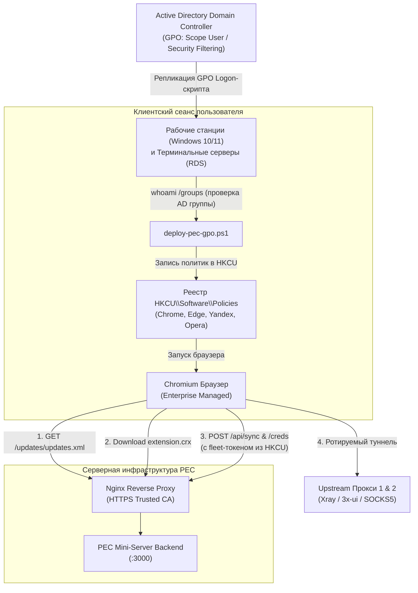

# Руководство по корпоративному развертыванию PEC через Active Directory GPO

Данное руководство предназначено для системных администраторов Active Directory и инженеров информационной безопасности. В нём пошагово описано, как настроить централизованное распространение и управление браузерным расширением PEC (Proxy Extension Corp) на рабочих станциях и многопользовательских терминальных серверах (RDS / Citrix).

---

## 1. Архитектура и ключевые принципы



### Основные принципы безопасности:
1. **Изоляция пользователей и RDS-терминалов:**
   Политики принудительной установки и настройки применяются в ветку **текущего пользователя (`HKCU\Software\Policies\...`)**, а не на весь компьютер. Это гарантирует, что на многопользовательском терминальном сервере расширение и доступ к прокси получает **только авторизованный сотрудник**, а сессии остальных пользователей остаются чистыми.
2. **Контроль доступа по группе безопасности AD:**
   Только члены указанной группы (например, `CORP\Proxy-Allowed-Users`) получают расширение. При исключении сотрудника из группы доступ автоматически отзывается, а политики удаляются.
3. **Защита от конфликтов индексов (Zero Collision):**
   Скрипт развертывания динамически вычисляет следующий свободный индекс в `ExtensionInstallForcelist`, не затирая другие корпоративные расширения (антивирусы, DLP).
4. **Гигиена секретов:**
   В GPO и клиентские скрипты передается исключительно низкопривилегированный **`EXT_SHARED_TOKEN`**. Административный токен управления панелью `ADMIN_TOKEN` строго изолирован на сервере.

---

## 2. Предварительные требования

1. **Сервер PEC за Nginx с валидным TLS-сертификатом:**
   Браузеры Chromium блокируют скачивание `.crx` из внешних источников, если SSL-сертификат является недоверенным (Untrusted Root / Self-signed) или просроченным. Сертификат Nginx должен быть выпущен доверенным корпоративным CA домена или публичным УЦ (Let's Encrypt / DigiCert / etc.).
2. **MIME-типы в Nginx:**
   Убедитесь, что в конфигурации Nginx отдаются правильные MIME-типы:
   ```nginx
   types {
       application/x-chrome-extension crx;
       application/xml xml;
   }
   ```
3. **Группа безопасности в Active Directory:**
   В оснастке `dsa.msc` создайте глобальную группу безопасности (например, `SEC-Proxy-Users`) и добавьте в неё пользователей, которым разрешён доступ к прокси.

---

## 3. Сценарий 1: Развертывание через GPO Logon-скрипт (Рекомендуемый)

Этот вариант является наиболее гибким, так как автоматически определяет все установленные на клиенте браузеры (Chrome, Edge, Яндекс Браузер, Opera), безопасно вычисляет индексы и мгновенно отзывает доступ при выходе из группы.

### Шаг 1. Получение пакета из веб-панели PEC
1. Откройте панель PEC: вкладка **«GPO Deployment»**.
2. Нажмите кнопку **«Скачать GPO Deployment Pack (.zip)»** (или скачайте отдельно скрипт `deploy-pec-gpo.ps1`).

### Шаг 2. Размещение скрипта в Netlogon / SysVol
Скопируйте `deploy-pec-gpo.ps1` в каталог скриптов политики на контроллере домена:
`\\<your-domain.corp>\SysVol\<your-domain.corp>\Policies\<GPO-GUID>\User\Scripts\Logon`  
или в общую сетевую папку с правами на чтение для всех пользователей домена (`\\<domain>\NETLOGON\scripts\`).

### Шаг 3. Создание и настройка GPO в GPMC
1. Откройте консоль **Group Policy Management** (`gpmc.msc`).
2. Создайте новый объект групповой политики: `PEC-Corp-Proxy-Extension`.
3. Привяжите GPO к OU с учетными записями пользователей (или к корню домена).
4. **Настройка фильтрации безопасности (Security Filtering):**
   - Выделите созданную GPO, откройте вкладку **Scope**.
   - В блоке **Security Filtering** удалите группу `Authenticated Users`.
   - Нажмите **Add** и выберите доменную группу `SEC-Proxy-Users`.
   - Перейдите на вкладку **Delegation**, нажмите **Advanced**:
     - Убедитесь, что группе `Authenticated Users` (или `Domain Computers`) предоставлено право **Read** (Чтение). Это обязательное требование Windows для корректного чтения политик.
5. **Подключение скрипта:**
   - Нажмите правой кнопкой мыши по GPO → **Edit** (Редактировать).
   - Перейдите в:  
     `User Configuration (Конфигурация пользователя) → Policies → Windows Settings → Scripts (Logon/Logoff) → Logon`.
   - В окне свойств перейдите на вкладку **PowerShell Scripts**.
   - Нажмите **Add**:
     - **Script Name:** `deploy-pec-gpo.ps1` (или полный UNC-путь `\\domain\netlogon\scripts\deploy-pec-gpo.ps1`).
     - **Script Parameters:** `-RequireAdGroup "SEC-Proxy-Users"`.
   - Нажмите **OK** и примените изменения.

---

## 4. Особенности для терминальных серверов (RDS / Citrix)

Если пользователи подключаются к многопользовательским терминальным серверам:
1. Терминальные серверы обычно находятся в отдельном подразделении (например, `OU=Terminal-Servers`).
2. Чтобы пользовательские настройки GPO гарантированно применялись к RDP-сессиям на сервере, включите **Режим замыкания пользовательской политики (Loopback Processing)**:
   - В GPMC перейдите в:  
     `Computer Configuration → Policies → Administrative Templates → System → Group Policy`.
   - Откройте политику: **Configure user Group Policy loopback processing mode** (Настроить режим обработки замыкания пользовательской групповой политики).
   - Установите: **Enabled** (Включено).
   - Выберите режим: **Merge** (Объединение).

При входе пользователя на терминал Windows применит `deploy-pec-gpo.ps1` в контексте его RDP-сессии, и прокси изолированно запустится только в его профиле браузера.

---

## 5. Сценарий 2: Развертывание через Group Policy Preferences (Registry)

Для администраторов, предпочитающих нативные элементы реестра без выполнения скриптов:

1. В веб-панели PEC скачайте файл `pec-policy-user-hkcu.reg` (выбрав переключатель *HKCU*).
2. В редакторе GPO перейдите в:  
   `User Configuration → Preferences → Windows Settings → Registry`.
3. Создайте элементы реестра:
   - **ExtensionInstallForcelist:**
     - Ветка: `Software\Policies\<Browser>\ExtensionInstallForcelist`
     - Имя: `1` (или свободный номер)
     - Значение: `<Extension_ID>;https://<domain>/updates/updates.xml`
   - **3rdparty managed storage:**
     - Ветка: `Software\Policies\<Browser>\3rdparty\extensions\<Extension_ID>\policy`
     - Параметры: `extToken` (REG_SZ), `syncUrl` (REG_SZ), `credsUrl` (REG_SZ), `autoConfigureProxy` (REG_DWORD = 1).
4. **Настройка нацеливания (Item-Level Targeting):**
   - В свойствах каждого элемента реестра перейдите на вкладку **Common** (Общие).
   - Отметьте: **Item-level targeting** → кнопка **Targeting...**.
   - Нажмите **New Item → Security Group** → выберите группу `SEC-Proxy-Users`.
   - Обязательно отметьте флаг: **«Remove this item when it is no longer applied»** (Удалить элемент, если он больше не применяется) — это обеспечит автоматический отзыв доступа при выходе из группы.

---

## 6. Проверка и диагностика на рабочих местах

### Автоматическая проверка через `verify-pec-gpo.ps1`
Запустите диагностический скрипт из архива на клиентском компьютере в PowerShell:
```powershell
.\verify-pec-gpo.ps1
```
Скрипт выполнит автоматические тесты и выведет статус:
```text
============================================================
 PEC Extension Corporate GPO Deployment Diagnostics
 Target Server: https://pec.corp.local
 Extension ID : abcdefghijklmnopabcdefghijklmnop
============================================================

--- 1. Network & TLS Certificate Verification ---
[PASS] PEC Server Reachability (/healthz) - HTTP 200 OK
[PASS] Update Manifest (/updates/updates.xml) - Found valid XML containing appid
[PASS] CRX Binary Download (/updates/extension.crx) - Content-Type: application/x-chrome-extension, Size: 48.5 KB

--- 2. Windows Registry Policy Verification ---
[PASS] Google Chrome Enterprise Policies - Configured in HKCU (Forcelist + Managed Storage)
[PASS] Microsoft Edge Enterprise Policies - Configured in HKCU (Forcelist + Managed Storage)
[PASS] Yandex Browser Enterprise Policies - Configured in HKCU (Forcelist + Managed Storage)
[PASS] Opera Enterprise Policies - Configured in HKCU (Forcelist + Managed Storage)

--- 3. Local Browser Profile Installation Status ---
[PASS] Google Chrome Installed Extension - Found version(s): 1.4.0
```

### Ручная проверка в браузерах:
1. Примените групповые политики на компьютере:
   ```cmd
   gpupdate /force
   ```
2. Откройте браузер и перейдите на страницу политик:
   - **Google Chrome:** `chrome://policy`
   - **Microsoft Edge:** `edge://policy`
   - **Яндекс.Браузер:** `browser://policy`
   - **Opera:** `opera://policy` (или `chrome://policy`)
3. Нажмите кнопку **«Перезагрузить политики» (Reload policies)**.
4. В таблице политик должны отображаться:
   - `ExtensionInstallForcelist` со статусом **OK**.
   - В блоке управляемых расширений: параметры `extToken`, `syncUrl`, `credsUrl`.

---

## 7. Траблшутинг (Частые вопросы)

| Симптом | Причина | Решение |
| :--- | :--- | :--- |
| Браузер не скачивает расширение из `updates.xml` | Недоверенный TLS-сертификат на Nginx | Убедитесь, что корневой сертификат корпоративного CA установлен в хранилище *«Доверенные корневые центры сертификации»* Windows. |
| Расширение установилось, но не подключается к прокси | Отсутствуют настройки в `3rdparty\extensions` | Проверьте наличие ветки `Software\Policies\<Browser>\3rdparty\extensions\<ID>\policy` и параметр `extToken`. |
| Политика не применилась к пользователю на RDS | Не включен Loopback Processing | Включите *Loopback Processing Mode = Merge* на OU терминальных серверов в GPMC. |
| При исключении пользователя из группы расширение остаётся | Не отработал скрипт отзыва | Скрипт `deploy-pec-gpo.ps1` с ключом `-RequireAdGroup` при входе пользователя без прав автоматически удаляет все ветки реестра PEC. |
| Изменился ID расширения после обновления сервера | Был утерян закрытый RSA-ключ | Убедитесь, что файл `extension/key.pem` сохранен в постоянном хранилище (или задан через переменную `PEC_PRIVATE_KEY_PEM`). |
